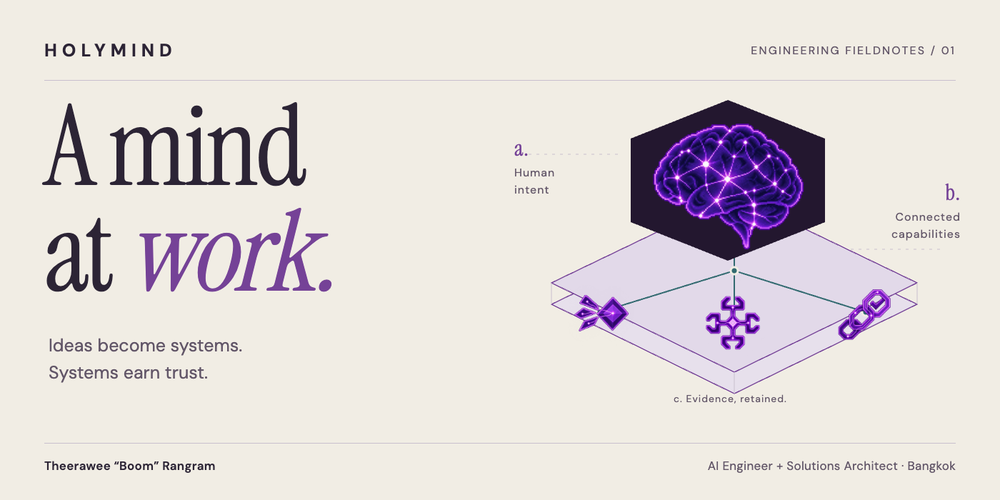
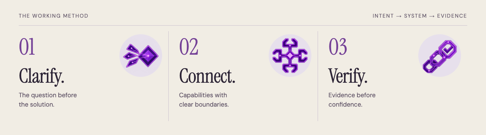

<a href="https://holyboom.github.io/">
  <picture>
    <source media="(max-width: 600px) and (prefers-color-scheme: dark)" srcset="assets/readme/cover-mobile-dark.png">
    <source media="(max-width: 600px)" srcset="assets/readme/cover-mobile-light.png">
    <source media="(prefers-color-scheme: dark)" srcset="assets/readme/cover-desktop-dark.png">
    
  </picture>
</a>

# Theerawee Rangram (Boom)

**AI Engineer & AI Solutions Architect · Bangkok, Thailand**

Creator of **HolyMind Framework**.

I turn ambitious business strategies into practical AI systems, agentic workflows and automation—with explicit permissions, human review and evidence people can inspect. My background spans **9+ years of software delivery** across banking, insurance, fintech and e-commerce.

**[Recruiter profile](https://holyboom.github.io/profile/)** · **[โปรไฟล์ภาษาไทย](https://holyboom.github.io/th/profile/)** · **[Connect on LinkedIn ↗](https://www.linkedin.com/in/boom-theerawee)**

> ธีรวีร์ รางแรม — เชื่อมโจทย์ธุรกิจ สถาปัตยกรรมซอฟต์แวร์ และการลงมือพัฒนา AI ให้เป็นระบบที่คนใช้งานและตรวจสอบได้

## Where I can contribute

**AI Solutions Architecture.** Requirements, system boundaries, integrations and a practical delivery plan.

**Applied GenAI & Agentic AI.** Model-and-tool workflows, LLM evaluation, guardrails and human-in-the-loop decisions.

**Enterprise implementation.** TypeScript, React, Angular, FastAPI and PostgreSQL access controls, informed by software delivery experience at ttb spark, Accenture and Allianz Technology.

Relevant conversations include **AI Solutions Architect, AI Engineer, GenAI Engineer, Forward Deployed Engineer** and **AI Transformation Consultant** roles. These describe role fit, not a list of past job titles.

## How I work

<picture>
  <source media="(max-width: 600px) and (prefers-color-scheme: dark)" srcset="assets/readme/method-mobile-dark.png">
  <source media="(max-width: 600px)" srcset="assets/readme/method-mobile-light.png">
  <source media="(prefers-color-scheme: dark)" srcset="assets/readme/method-desktop-dark.png">
  
</picture>

**Clarify the goal. Connect the capabilities. Verify the result.**

The HolyMind showcase turns that approach into an inspectable public example: three illustrative business workflows, explicit input boundaries, source-to-output inspection and a planning brief that preserves the visitor’s choices. It is a portfolio demonstration—not a live AI service or a claimed client outcome.

[Explore the live work](https://holyboom.github.io/) · [Inspect the source](workflow-proof.js) · [Read my experience](https://holyboom.github.io/profile/#fit-heading)

<strong>Technical notes and credits</strong>

This repository serves the static portfolio on GitHub Pages. [Engineering notes](docs/ENGINEERING.md) cover local setup and architecture. Original HolyMind artwork and third-party assets retain their [individual notices](assets/brand-attribution.md); see the [audio credits](https://holyboom.github.io/audio-credits.html).

---

**Hiring for a business problem that needs working AI?** [Let’s discuss the role on LinkedIn →](https://www.linkedin.com/in/boom-theerawee)
